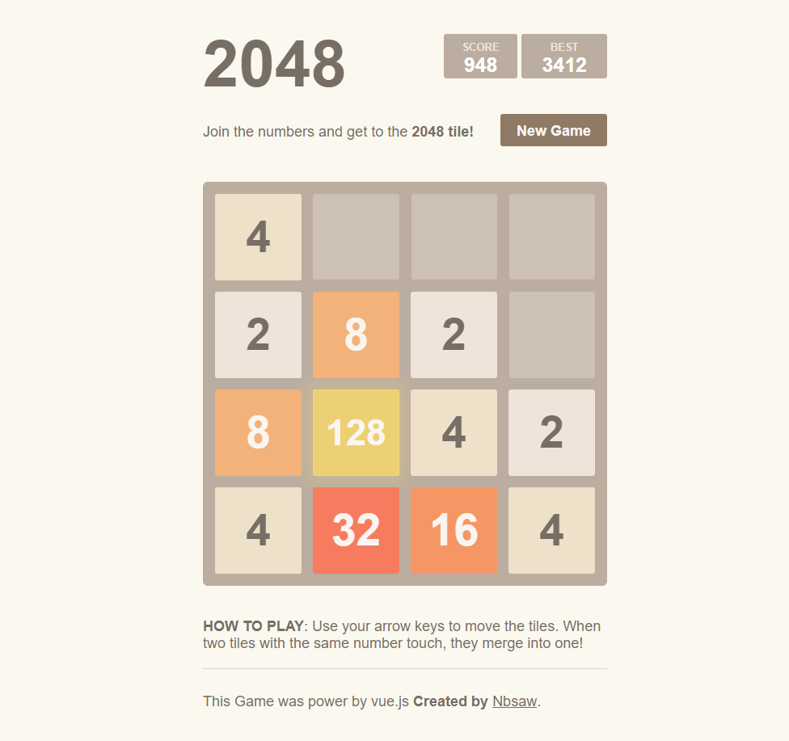

# 2048

一个基于 Vue 2 实现的 2048 网页游戏。

项目将棋盘状态、移动合并逻辑和输入处理拆分为独立模块，并使用 Vue 负责界面渲染与状态展示。

## 预览



## 技术栈

- Vue 2
- JavaScript
- Sass
- Webpack

## 本地运行

```bash
npm install
npm run dev
```

生产构建：

```bash
npm run build
```
